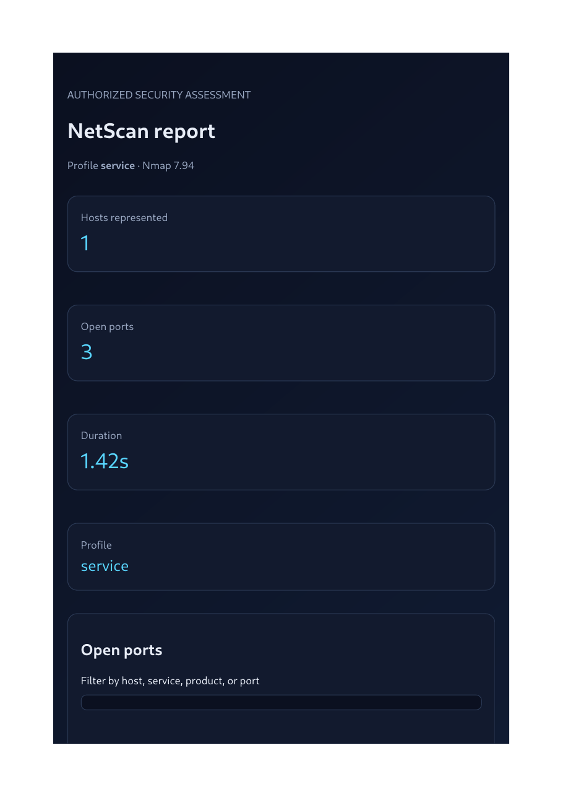
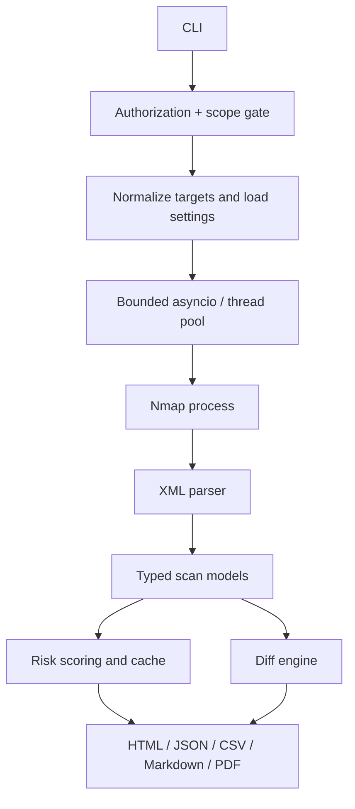

<div align="center">

# NetScan

**Authorized network scanning, explainable risk scoring, scan diffing, and polished multi-format reports.**

[](https://github.com/KisholoyDD21/NetScan/actions/workflows/ci.yml)


</div>

> **Discover. Assess. Report.** NetScan turns authorized Nmap scans into structured results that are easy to review, compare, and share.

> [!CAUTION]
> **LEGAL & ETHICAL USE:** Scan only systems you own or have explicit written authorization to test. Every scan requires both `--authorized` and a scope file, and targets outside the declared scope are rejected. You are responsible for permissions, applicable laws, and avoiding service disruption. Do not use this tool against public or third-party ranges without documented authorization.

NetScan is a Python command-line tool for authorized network assessments. It orchestrates Nmap, parses XML into typed results, assigns explainable heuristic risk scores, compares scans, and creates reports for both people and automation.

| Scan safely | Understand results | Track changes | Share findings |
|---|---|---|---|
| Authorization flag and strict YAML scope checks | Host, port, service, and risk summaries | Compare JSON baselines across scans | Self-contained HTML plus JSON, CSV, Markdown, and optional PDF |

## Contents

- [Demo](#demo)
- [Features](#features)
- [Quickstart](#60-second-quickstart)
- [Profiles and examples](#profiles-runnable-examples)
- [Architecture](#architecture)
- [Configuration](#configuration-reference)
- [Security notes](#security-and-operational-notes)
- [Development](#development)
- [Contributing](#contributing)
- [License](#license)

## Demo

Run a small scan against a target explicitly included in your scope file:

```text
$ netscan scan --targets 127.0.0.1 --scope-file scope.yaml --authorized --profile quick --report html --report json
LEGAL / ETHICAL USE  Use only against systems you own or are explicitly authorized to assess.
Scanning authorized targets ━━━━━━━━━━━━━━━━━━━━ 1/1 0:00:02
Completed 127.0.0.1: 2 open ports
Report written: reports/netscan-quick-20261009-120000.html
Report written: reports/netscan-quick-20261009-120000.json
┏━━━━━━━━━━━━━━━ NetScan summary ━━━━━━━━━━━━━━━┓
┃ Host       Hostname   Status   Open ports Risk ┃
┃ 127.0.0.1  localhost  up       2          Low  ┃
┗━━━━━━━━━━━━━━━━━━━━━━━━━━━━━━━━━━━━━━━━━━━━━━━┛
```

### Report preview

The preview uses synthetic fixture data; it does not expose results from a real network scan.



[Open the sample HTML report](docs/assets/sample-report.html) · The sample report and preview use synthetic data. The terminal output above is illustrative; run NetScan in an authorized lab to produce your own results.

## Features

| Capability | Details |
|---|---|
| **Scope-first safety** | Requires `--authorized` and a YAML scope file; out-of-scope targets are rejected before scanning. |
| **Flexible targets** | Accepts IPs, CIDRs, hostnames, comma-separated inputs, and target files. Large networks have expansion limits and require explicit acknowledgement. |
| **Nine scan profiles** | Discovery, quick, full TCP, stealth, service/version, UDP top ports, OS detection, guarded NSE vulnerability checks, and allowlisted custom flags. |
| **Bounded execution** | Async orchestration with a worker pool, per-target progress, console logging, and rotating JSON logs. |
| **Typed results** | Host, port, service, script, and scan metadata models with versioned JSON output. |
| **Useful reports** | Self-contained dark HTML reports with filtering and sortable tables, plus JSON, CSV, Markdown, and optional PDF. |
| **Risk and change tracking** | Offline heuristic risk scoring and JSON baseline diffs for host, port, and service-fingerprint changes. |
| **Developer-friendly** | Optional TTL cache, Docker image, VS Code F5 configurations, tests that do not require Nmap, and CI for Python 3.11/3.12 on Ubuntu and Windows. |

## 60-second quickstart

### 1. Create environment and install

```bash
python -m venv .venv
# Windows PowerShell
.venv\Scripts\Activate.ps1
# macOS/Linux
source .venv/bin/activate
python -m pip install -e ".[dev]"
```

### 2. Install Nmap

- **Windows:** installer from [nmap.org/download.html](https://nmap.org/download.html); add Nmap to `PATH`.
- **macOS:** `brew install nmap`.
- **Debian / Ubuntu / Kali:** `sudo apt install nmap`.
- **Fedora:** `sudo dnf install nmap`.

Verify with `nmap --version`. NetScan reports a clear error and OS-specific hints if the binary is absent. Unit tests do not need it.

### 3. Declare exact scope

```bash
cp examples/scope.example.yaml scope.yaml
```

Edit `scope.yaml` to contain **only** your authorized targets. The example includes localhost and an illustrative private lab range; remove everything that is not explicitly authorized. `scope.yaml` is git-ignored.

### 4. Run an initial discovery scan

```bash
netscan scan --targets 127.0.0.1 --scope-file scope.yaml --authorized --profile discovery --report html --report json
```

Add `--report csv --report md` to generate more formats. PDF requires `pip install 'netscan[pdf]'` and the platform libraries required by WeasyPrint.

## Profiles: runnable examples

All examples assume `scope.yaml` explicitly includes the target and that you have written permission.

```bash
# Host discovery only
netscan scan --targets 127.0.0.1 --scope-file scope.yaml --authorized --profile discovery
# Top 100 TCP ports
netscan scan --targets 127.0.0.1 --scope-file scope.yaml --authorized --profile quick
# Full TCP port inventory (potentially long-running)
netscan scan --targets 127.0.0.1 --scope-file scope.yaml --authorized --profile full-tcp
# SYN scan; will downgrade to TCP connect when insufficiently privileged
netscan scan --targets 127.0.0.1 --scope-file scope.yaml --authorized --profile stealth
# Service / version detection
netscan scan --targets 127.0.0.1 --scope-file scope.yaml --authorized --profile service
# UDP top 50 ports; potentially slow
netscan scan --targets 127.0.0.1 --scope-file scope.yaml --authorized --profile udp-top
# OS fingerprinting; may be omitted without suitable privileges
netscan scan --targets 127.0.0.1 --scope-file scope.yaml --authorized --profile os-detect
# Nmap NSE vuln category: explicit additional acknowledgment required
netscan scan --targets 127.0.0.1 --scope-file scope.yaml --authorized --profile vuln --allow-vuln-scripts
# Allowlisted custom flags
netscan scan --targets 127.0.0.1 --scope-file scope.yaml --authorized --profile custom --custom-flags "-sV --top-ports 20"
# Optional NVD keyword enrichment (sends discovered product/version strings to NVD)
netscan scan --targets 127.0.0.1 --scope-file scope.yaml --authorized --profile service --cve-enrichment
```

### Target input and scheduling

```bash
netscan scan --targets "127.0.0.1,localhost" --scope-file scope.yaml --authorized
netscan scan --targets-file examples/targets.example.txt --scope-file scope.yaml --authorized
netscan scan --targets 192.168.56.0/24 --scope-file scope.yaml --authorized --workers 4
netscan scan --targets 127.0.0.1 --scope-file scope.yaml --authorized --sequential
netscan scan --targets 127.0.0.1 --scope-file scope.yaml --authorized --cache-ttl 600
```

Networks larger than the configured expansion ceiling require `--i-know-this-is-big`; acknowledgment permits expansion up to the hard ceiling of 65,536 normalized targets. Keep scope narrow and use this only for explicitly authorized assessments.

### Every report format

```bash
netscan scan --targets 127.0.0.1 --scope-file scope.yaml --authorized --report html --report json --report csv --report md
netscan scan --targets 127.0.0.1 --scope-file scope.yaml --authorized --report pdf
```

Repeat `--report` for each desired output. Outputs go to `reports/` by default. PDF is an optional dependency.

### Scan diffs and CI risk threshold

```bash
netscan diff reports/baseline.json reports/current.json
netscan scan --targets 127.0.0.1 --scope-file scope.yaml --authorized --compare-with reports/baseline.json --report html --report json
netscan scan --targets 127.0.0.1 --scope-file scope.yaml --authorized --fail-on-risk 45 --report json
```

Diff output identifies new/removed hosts, newly open/closed ports, and service fingerprint changes. Risk scoring is a lightweight heuristic, not a CVE verdict.

## Architecture



See [docs/architecture.md](docs/architecture.md), [docs/usage.md](docs/usage.md), and [docs/profiles.md](docs/profiles.md). `python-nmap` handles built-in profile scans through an isolated, timed child process; custom and opt-in NSE vulnerability scans use raw argument-list `subprocess` execution with `-oX -` so advanced flags share the same XML parser contract. Both execution paths use list arguments and avoid `shell=True`.

## Configuration reference

Use `--config path/to/netscan.yaml`. CLI values override YAML defaults for the profile, target selection, output directory, workers, cache TTL, and safety acknowledgements.

| Key | Default | Meaning |
|---|---:|---|
| `default_profile` | `quick` | Documented default profile; pass `--profile` to override. |
| `timeout_seconds` | `300` | Timeout for each Nmap process. |
| `output_dir` | `reports` | Report destination. |
| `exclude_hosts` | `[]` | Exact normalized targets to exclude. |
| `max_workers` | `4` | Concurrent target worker cap (1–32). |
| `rate_delay_seconds` | `0.0` | Delay before each worker starts. |
| `cache_dir` | `.netscan_cache` | TTL result cache path. |
| `log_dir` | `logs` | Intended rotating log directory. |
| `max_targets` | `4096` | Maximum expanded target count. |

Environment variables use the `NETSCAN_` prefix for Pydantic settings, e.g. `NETSCAN_MAX_WORKERS=2`.

## Exit codes

| Code | Meaning |
|---:|---|
| `0` | Successful report generation and no risk threshold breach. |
| `1` | Runtime, configuration, scan, or report error. |
| `2` | Usage error, unknown profile/format, or missing special acknowledgment. |
| `3` | Authorization flag/scope missing, expired, or target out of scope. |
| `4` | Nmap executable missing. |
| `5` | At least one host met the `--fail-on-risk` threshold. |

## Security and operational notes

- Scope lists must be explicit, current, and owned by the operator. Scope files are not a substitute for signed authorization.
- The `custom` profile accepts only a narrow allowlist; flags for external target lists, output redirection, NSE scripts, and shell syntax are rejected.
- `stealth` is not anonymity. Privileged scan types are downgraded if elevation is unavailable; TCP connect scanning is still visible to target systems.
- The tool does not run exploit payloads and does not infer CVEs from banners. NSE `vuln` scripts are opt-in and may have operational impact.
- DNS names are normalized but not resolved by NetScan before scope checks. For CIDR scopes, use IP addresses or explicit network targets.
- Use the cache as an optimization, not as authoritative current state. A stale or incomplete result can mislead comparisons.

## What I learned / design decisions

- **XML is a stable boundary:** isolating parsing from the process makes result handling deterministic and unit-testable on machines without Nmap.
- **Authorization is an invariant:** it belongs before orchestration, not as an optional warning or a late-stage check.
- **Risk is explainable, not magical:** the local score rewards review and prioritization, but intentionally avoids pretending that open ports establish exploitability.
- **Multi-format output should share one model:** reports stay consistent because they serialize the same dataclasses.
- **Least privilege affects scan behavior:** privileged options degrade with warnings rather than silently failing or claiming stronger coverage than occurred.

## Roadmap

- Expand property-based fuzzing for XML and scope validation.
- Add per-host partial-result recovery and graceful interrupt checkpoints for in-flight scans.
- Add structured progress events and a true streaming live-port view.
- Add CVE source attribution and confidence-aware matching for optional enrichment.
- Extend HTML accessibility checks and publish a live report generated from a disposable local lab.
- Raise coverage targets after adding more command-invocation and Windows-specific tests.

## Development

```bash
pip install -e ".[dev]"
ruff check src tests
black --check src tests
mypy --strict src/netscan
pytest
pre-commit install
```

Tests mock scanning boundaries and should run without Nmap. CI covers Python 3.11/3.12 on Ubuntu and Windows.

## Contributing

Read [CONTRIBUTING.md](CONTRIBUTING.md) and [SECURITY.md](SECURITY.md). Every change that affects targets, argument construction, privileges, or scope enforcement should include dedicated tests.

## License

MIT — see [LICENSE](LICENSE).
