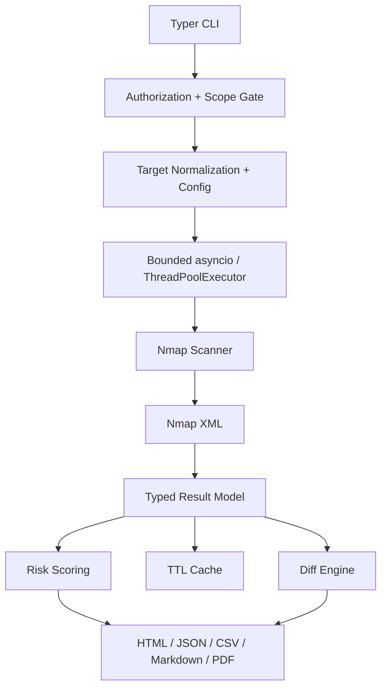

# Architecture

## Data flow

1. The CLI requires `--authorized` and a YAML `--scope-file` before invoking Nmap.
2. Targets are normalized and expanded within a configured ceiling; every target must be covered by scope.
3. Each target is scanned in a bounded worker pool. Nmap receives an argument list, never a shell command string.
4. XML is parsed into dataclasses. Risk scoring is deterministic and offline.
5. Reports consume the same versioned model. Diffing reads stored JSON and makes no network calls.

## Design notes

`python-nmap` handles built-in profile scans inside an isolated child process with an outer timeout. Custom profiles and the opt-in NSE vulnerability profile use a raw argument-list subprocess path with `-oX -`, so advanced options remain explicit and the parser sees the same XML contract. Both paths are isolated behind the scanner module; no shell command string is executed. All tests mock or bypass the subprocess layer, so Nmap need not be installed to run the unit suite.
